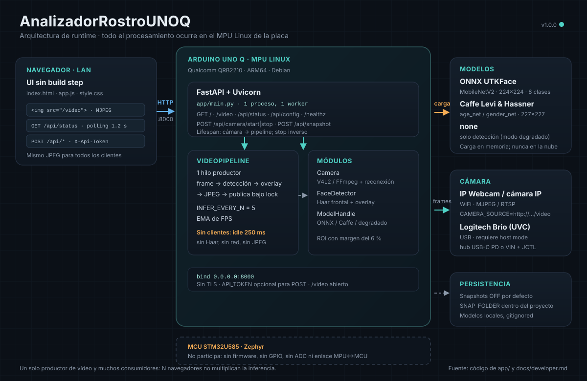
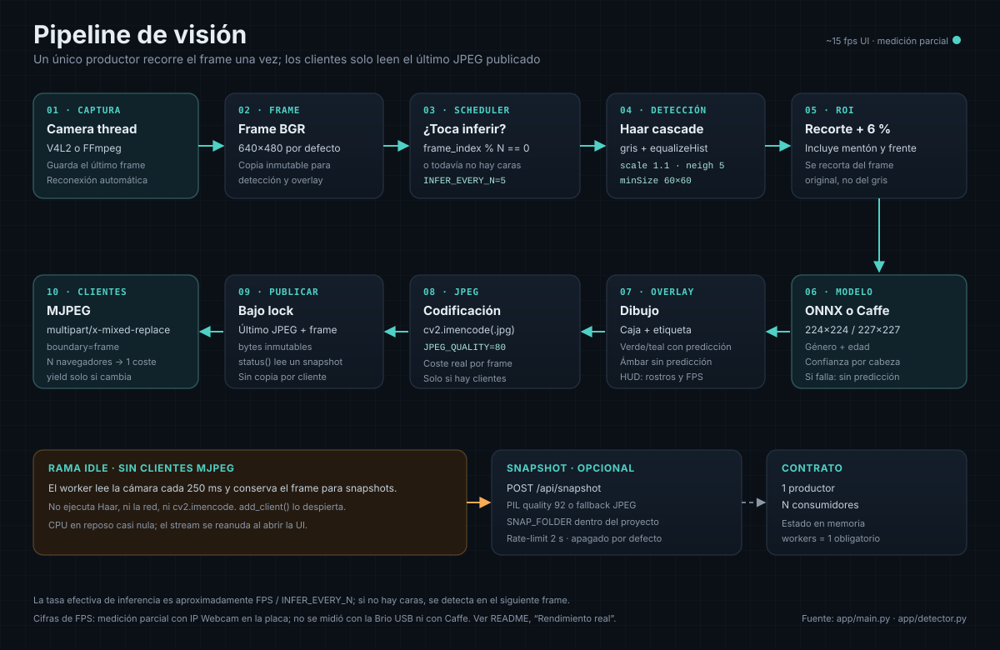
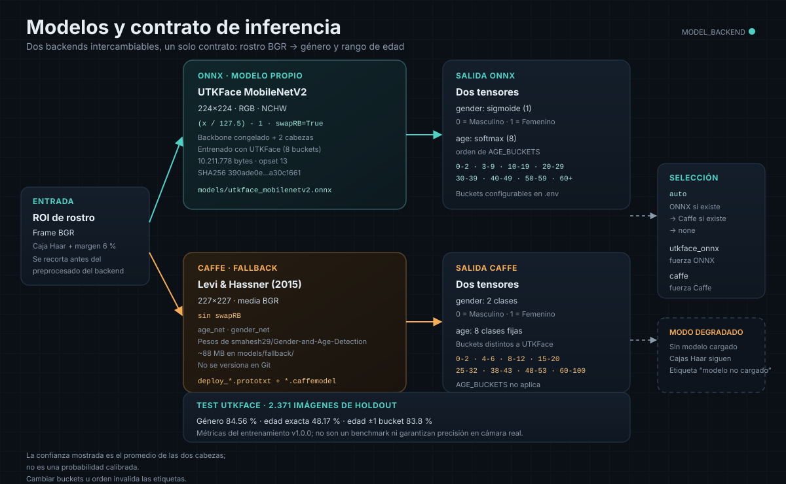

# AnalizadorRostroUNOQ

**Detección de rostros y estimación de género + rango de edad en la Arduino UNO Q, con interfaz web en español y procesamiento 100 % local.**

[](https://www.python.org/)
[](https://fastapi.tiangolo.com/)
[](https://opencv.org/)
[](https://onnx.ai/)
[](https://docs.arduino.cc/hardware/uno-q)
[](LICENSE)

> **Convención de red:** todos los ejemplos usan direcciones del bloque
> `192.0.2.0/24`, reservado por la RFC 5737 para documentación. Sustituye
> `192.0.2.x` por la IP real de tu placa o de tu cámara. Nunca publiques tu
> `.env` ni la IP privada de tu instalación.

Aplicación **Python / FastAPI** que corre en el **MPU Linux (Qualcomm QRB2210, ARM64, Debian)** de la Arduino UNO Q. Captura vídeo de una **Logitech Brio USB** o de una **cámara IP/MJPEG por WiFi** (por ejemplo, IP Webcam en un teléfono), detecta rostros con el clasificador **Haar** de OpenCV y clasifica **género** y **rango de edad** con uno de dos backends: un modelo **ONNX propio entrenado con UTKFace** o el **fallback Caffe de Levi & Hassner**. El vídeo anotado se sirve como **stream MJPEG** a cualquier navegador de la red local.

> **No es un sketch `.ino`.** Este proyecto no se compila con `arduino-cli` ni ejecuta inferencia en el MCU STM32U585. Todo el runtime vive en el lado Linux de la placa. Ver [¿Por qué no se usa arduino-cli?](#por-qué-no-se-usa-arduino-cli).

---

## Tabla de contenidos

1. [Estado del proyecto](#estado-del-proyecto)
2. [Qué es y qué no es](#qué-es-y-qué-no-es)
3. [Arquitectura](#arquitectura)
4. [Principio de funcionamiento](#principio-de-funcionamiento)
5. [Pipeline de visión](#pipeline-de-visión)
6. [Modelos y contrato de inferencia](#modelos-y-contrato-de-inferencia)
7. [Hardware requerido](#hardware-requerido)
8. [Software e instalación](#software-e-instalación)
9. [Puesta en marcha paso a paso](#puesta-en-marcha-paso-a-paso)
10. [Recursos, "pinout" y conexión](#recursos-pinout-y-conexión)
11. [Configuración (.env)](#configuración-env)
12. [API HTTP](#api-http)
13. [Operación de la interfaz web](#operación-de-la-interfaz-web)
14. [Calibración y rendimiento real](#calibración-y-rendimiento-real)
15. [Entrenamiento del modelo UTKFace](#entrenamiento-del-modelo-utkface)
16. [Ejemplos de uso realistas](#ejemplos-de-uso-realistas)
17. [Cómo fue construido](#cómo-fue-construido)
18. [Solución de problemas](#solución-de-problemas)
19. [Privacidad y datos biométricos](#privacidad-y-datos-biométricos)
20. [Límites honestos](#límites-honestos)
21. [Atribuciones y licencias](#atribuciones-y-licencias)
22. [Advertencias específicas de la UNO Q](#advertencias-específicas-de-la-uno-q)
23. [Estructura del repositorio](#estructura-del-repositorio)
24. [Referencias](#referencias)
25. [Documentación adicional](#documentación-adicional)
26. [Licencia](#licencia)

---

## Estado del proyecto

| Aspecto | Estado |
|---|---|
| Código de la aplicación | Completo; auditoría estática **APROBADA sin incidencias** (la auditoría interna, ciclo 2). |
| Verificación en host | `py_compile` de todos los módulos, `bash -n` de los scripts, `node --check` del frontend y `train_utkface.py --self-test` (9/9) ejecutados correctamente según la auditoría interna. |
| Modelos Caffe fallback | **Presentes localmente** en `models/fallback/` (~88 MB: `age_net.caffemodel` 45.7 MB, `gender_net.caffemodel` 45.6 MB, 2 prototxt). **Excluidos de Git** por `.gitignore`. |
| Modelo ONNX UTKFace | **Entrenado (v1.0.0)** con UTKFace y publicado como asset del release. Métricas de test: género **84.56 %**, edad exacta **48.17 %**, edad ±1 bucket **83.8 %**. El `.onnx` **no se versiona** en Git: descárgalo con `gh release download` o reentrénalo con `training/`. `MODEL_BACKEND=auto` lo prefiere sobre Caffe. Si el asset no está disponible, la app sigue funcionando con Caffe o en modo degradado. |
| Despliegue en hardware | **Verificado en la UNO Q.** App instalada y corriendo como servicio `unoq-app`; UI en `http://192.0.2.10:8000`, SSH 22/2222 y modelo ONNX cargado. La cámara validada fue **IP Webcam** (MJPEG por WiFi), no la Brio USB. |
| Rendimiento real | **Medido parcialmente** en QRB2210: stream IP Webcam 1920×1080 reducido a 640×360, ~15 fps en la UI, inferencia ONNX cada 5 frames. No se probó la Brio por USB: falta un hub USB-C con PD o el puente JCTL + alimentación por VIN. |

> **Honestidad técnica:** cualquier tabla, captura o JSON de ejemplo con cifras concretas está marcado como *ilustrativo* y no debe interpretarse como una medición hecha en la placa.

---

## Qué es y qué no es

| ✅ Es | ❌ No es |
|---|---|
| Una app web autocontenida servida desde el MPU Linux de la UNO Q. | Un sketch Arduino / `.ino`. |
| Detección de rostros frontales con Haar cascade. | Un sistema de reconocimiento facial (no identifica personas). |
| Estimación de género binario y rango de edad en 8 buckets. | Un sensor de edad exacta ni una medición médica. |
| Inferencia local en CPU con OpenCV DNN (ONNX o Caffe). | Inferencia en el MCU STM32U585 / Zephyr / TensorFlow Lite Micro. |
| Stream MJPEG para varios navegadores con un solo worker. | Un servidor WebRTC, RTSP o HLS. |
| Snapshots **desactivados por defecto**. | Un sistema de videovigilancia con grabación continua. |

**Resultado esperado:** una página en `http://<IP_UNO_Q>:8000/` con el vídeo en vivo, cajas sobre los rostros y etiquetas del tipo `Femenino | 20-29 (84%)`, un contador de rostros y FPS.

---

## Arquitectura



*Diagrama de runtime. El MCU STM32U585 no participa; todo ocurre en el MPU Linux.*

La app tiene tres planos: el **navegador** (UI y stream MJPEG), el **MPU Linux** (FastAPI, un único hilo de vídeo, detector y modelo) y la **fuente de vídeo** (cámara IP por WiFi o cámara USB UVC). El estado vive en memoria: no hay base de datos, cola ni servicio externo. El puerto `8000` es la única superficie de red.

### Módulos

| Archivo | Responsabilidad |
|---|---|
| `app/main.py` | App FastAPI, endpoints, worker de vídeo, generador MJPEG, control de cámara, snapshots. |
| `app/config.py` | Carga de `.env`, validación, rutas seguras, configuración pública. |
| `app/camera.py` | `cv2.VideoCapture` en hilo dedicado, reconexión, lectura thread-safe. |
| `app/detector.py` | Haar cascade, ROI con margen, overlay de cajas/etiquetas/HUD. |
| `app/models_loader.py` | Backends ONNX y Caffe, preprocesado y contrato de predicción. |
| `python/main.py` | Entrypoint compatible con Arduino App Lab. |
| `static/` | UI sin build step (HTML + CSS + JS vanilla). |
| `training/` | Entrenamiento UTKFace fuera de la placa. |
| `scripts/` | Descarga de modelos, setup en placa, despliegue y arranque. |

---

## Principio de funcionamiento

1. **Arranque.** `load_settings()` lee `.env` y el entorno. `load_model()` intenta cargar el backend pedido (`auto` → ONNX → Caffe → ninguno). `FaceDetector` carga `haarcascade_frontalface_default.xml` (incluido en OpenCV).
2. **Captura.** `Camera` abre la fuente configurada. Si `CAMERA_SOURCE` contiene una URL (`http(s)://`, `rtsp://`, `rtmp://`) usa `CAP_FFMPEG`; si está vacío, abre `/dev/videoN` con `CAP_V4L2` (Linux) y, si falla, `CAP_ANY`. Fija resolución, FPS y `BUFFERSIZE=1` para minimizar latencia. Un hilo guarda siempre el último frame y se reconecta si la fuente desaparece (20 lecturas fallidas → reapertura cada 2 s).
3. **Pipeline único.** `VideoPipeline` es el **único** hilo que lee cámara, detecta, clasifica, dibuja y codifica. Publica el último JPEG protegido por lock. Los clientes de `/video` solo copian ese JPEG: **N navegadores no multiplican la CPU**.
4. **Detección.** Cada `INFER_EVERY_N` frames (o si aún no hay caras), el frame se convierte a gris, se ecualiza (`equalizeHist`) y se pasa a `detectMultiScale(scaleFactor=1.1, minNeighbors=5, minSize=(60,60))`. Cada caja se recorta con un **margen del 6 %** para incluir mentón/frente.
5. **Clasificación.** Cada ROI se envía al backend activo. Género se devuelve como `Masculino`/`Femenino`; edad como uno de los 8 buckets configurados. Si la confianza individual de una cabeza no supera `CONF_THRESHOLD`, la etiqueta conserva la clase estimada pero la prefija con `~` y la cierra con `?` (por ejemplo, `~20-29?`).
6. **Overlay.** Se dibujan cajas (verde/teal si hay predicción, ámbar si no), etiqueta `Género | Edad (conf%)` y HUD `Rostros: N | FPS: x.x`. El porcentaje mostrado es el **promedio** de las confianzas de género y edad.
7. **Publicación.** El frame anotado se codifica a JPEG (`JPEG_QUALITY`, por defecto 80) y se publica. `/video` emite chunks `multipart/x-mixed-replace; boundary=frame`.
8. **Reposo.** Si no hay clientes MJPEG, el worker entra en modo idle: lee la cámara cada 250 ms, **no ejecuta Haar ni la red y no codifica JPEG**. Esto mantiene el frame disponible para snapshots con CPU casi nula. Al conectarse un cliente, `add_client()` despierta al worker.

### Backends

| Backend | Entrada | Preprocesado | Salidas | Buckets de edad |
|---|---|---|---|---|
| `utkface_onnx` | 224×224 | `blobFromImage(face, 1/127.5, (224,224), (127.5,127.5,127.5), swapRB=True)` | `gender` sigmoide (0=M, 1=F), `age` softmax 8 | `AGE_BUCKETS` (configurable, 8 valores) |
| `caffe` | 227×227 | `blobFromImage(face, 1.0, (227,227), mean BGR, swapRB=False)` | `gender_net` 2 clases (0=M, 1=F), `age_net` 8 clases | **Fijos en código**: `0-2, 4-6, 8-12, 15-20, 25-32, 38-43, 48-53, 60-100` |
| `none` (degradado) | — | — | Etiqueta `Rostro detectado \| modelo no cargado` | — |

> ⚠️ Los buckets del modelo Caffe **no son** los de UTKFace. `AGE_BUCKETS` solo se aplica al backend ONNX. Si mezclas ambos verás rangos distintos en pantalla.

---

## Pipeline de visión



*Un productor, muchos consumidores. El frame se procesa una vez y se publica como JPEG inmutable.*

| Etapa | Implementación | Parámetro | Coste relativo |
|---|---|---|---|
| 1. Captura | Hilo `Camera` con `cv2.VideoCapture`; `CAP_FFMPEG` para URL y `CAP_V4L2` para `/dev/videoN`. Guarda el último frame y reconecta tras 20 lecturas fallidas. | `CAMERA_SOURCE`, `CAMERA_INDEX`, `WIDTH`, `HEIGHT`, `FPS_TARGET` | Bajo, dominado por la red o el driver UVC |
| 2. Programación | El worker decide si toca inferir: `frame_index % INFER_EVERY_N == 0` o todavía no hay caras. | `INFER_EVERY_N` (5 por defecto) | Despreciable |
| 3. Detección | BGR → gris → `equalizeHist` → `detectMultiScale(1.1, 5, minSize=(60,60))`. | `HAAR_PATH`, `CONF_THRESHOLD` (filtro de etiqueta) | Bajo; Haar es barato en CPU |
| 4. ROI | Cada caja se recorta del frame **original** con un margen del 6 % para incluir mentón y frente. | Fijo en `app/detector.py` | Muy bajo |
| 5. Clasificación | ONNX 224×224 o Caffe 227×227; dos cabezas, género y edad. | `MODEL_BACKEND`, rutas de modelo | **Alto**; es el coste dominante |
| 6. Overlay | Caja teal si hay predicción, ámbar si no; etiqueta y HUD con rostros/FPS. | `CONF_THRESHOLD` | Bajo |
| 7. JPEG | `cv2.imencode(".jpg", frame, [IMWRITE_JPEG_QUALITY, q])`. | `JPEG_QUALITY` (80) | Medio; crece con resolución y calidad |
| 8. Publicación | `_publish()` guarda JPEG + frame + caras bajo lock. Los clientes leen el último JPEG. | — | Muy bajo |
| 9. Entrega | `StreamingResponse` con `multipart/x-mixed-replace; boundary=frame`; `yield` solo cuando cambia el JPEG. | — | Red; un coste para N clientes |

**Tasa efectiva de inferencia.** Con caras presentes, se infiere aproximadamente `FPS / INFER_EVERY_N` veces por segundo. Con `FPS_TARGET=15` e `INFER_EVERY_N=5`, son unas 3 inferencias/s: suficiente para que la etiqueta no parpadee, pero no para seguir a una persona que se mueve rápido. Si no hay caras, se vuelve a detectar en el siguiente frame para no quedarse “ciego”.

**Concurrencia.** Hay un solo hilo productor y un lock corto para publicar. No hay cola: si el modelo tarda, el worker pierde frames (descarta) en lugar de acumular latencia. Los clientes MJPEG no ejecutan inferencia; solo copian bytes. Por eso `workers=1` es obligatorio: dos procesos abrirían la cámara dos veces y competirían por el mismo dispositivo.

**Reposo.** Si `stream_clients == 0`, el worker lee la cámara cada 250 ms y no ejecuta Haar, red ni JPEG. El frame se conserva para que `POST /api/snapshot` pueda responder. Al abrir la UI, `add_client()` despierta al worker y el stream se reanuda.

**Lo que el pipeline no hace:** no hay tracking entre frames, ni suavizado temporal de etiquetas, ni buffer de vídeo, ni grabación continua. Cada frame es independiente; por eso una cara puede cambiar de bucket entre inferencias si el modelo duda.

---

## Modelos y contrato de inferencia



*Dos backends intercambiables. El contrato de entrada y el orden de los buckets son parte de la API del modelo.*

### Model card — ONNX UTKFace v1.0.0

| Campo | Valor |
|---|---|
| Arquitectura | MobileNetV2 (`include_top=False`, pesos ImageNet congelados) + dos cabezas densas |
| Entrada | NCHW `[N, 3, 224, 224]`, RGB, normalizada `x/127.5 - 1` (`swapRB=True`) |
| Salidas | `gender`: sigmoide de 1 valor (0 = Masculino, 1 = Femenino); `age`: softmax de 8 clases |
| Entrenamiento | UTKFace, 10 epochs, batch 64, Adam `1e-4`, `loss_weights` género 1.0 / edad 2.0 |
| Split | 80 % train / 10 % validación / 10 % test |
| Métricas de test | Género **84.56 %**; edad exacta **48.17 %**; edad ±1 bucket **83.8 %** (2.371 imágenes) |
| Tamaño | **10.211.778 bytes** (~9.8 MB) |
| SHA256 | `390ade0e1f237616aca4636976f3223f1b8396e4bb539c27a4b55848a30c1661` |
| Formato | ONNX, **opset 13** |
| Licencia | Código MIT; modelo derivado de UTKFace con fines de investigación. No usar para vigilancia ni decisiones automatizadas. |

El detalle de entrenamiento, aumentación y exportación está en [`training/README.md`](training/README.md). El workflow de GitHub Actions entrena en un runner CPU (Python 3.11, TensorFlow 2.15.1, tf2onnx 1.16.1); la corrida de referencia tardó ~37 minutos para 10 epochs.

### Selección de backend

```text
MODEL_BACKEND=auto   → intenta ONNX; si falta o falla, Caffe; si tampoco, none
MODEL_BACKEND=utkface_onnx → solo ONNX (si falla, none)
MODEL_BACKEND=caffe  → solo Caffe (si falla, none)
```

El backend efectivo se ve en `/api/status` (`model_backend`) y el pedido en `model_backend_requested`. Si `model_loaded=false`, la app sigue detectando rostros y dibuja la etiqueta `Rostro detectado | modelo no cargado`: es el **modo degradado**, no un crash.

### Buckets: el detalle que rompe etiquetas

| Backend | Buckets | ¿Configurable? |
|---|---|---|
| ONNX UTKFace | `0-2, 3-9, 10-19, 20-29, 30-39, 40-49, 50-59, 60+` | Sí, `AGE_BUCKETS` (exactamente 8) |
| Caffe Levi & Hassner | `0-2, 4-6, 8-12, 15-20, 25-32, 38-43, 48-53, 60-100` | **No**; fijos en `models_loader.py` |

Cambiar el orden o la cantidad de `AGE_BUCKETS` en ONNX **no reentrena** el modelo: solo reetiqueta las 8 salidas. Si el orden no coincide con el usado al entrenar, las etiquetas serán incorrectas aunque el código no falle.

### Sobre YuNet

El detector de esta versión es **Haar cascade**, no YuNet. YuNet es una CNN ligera de OpenCV Zoo, más robusta con perfiles y luz difícil, pero añade un modelo extra y un preprocesado distinto. Se documenta como **evolución recomendada** en [`docs/developer.md`](docs/developer.md), no como dependencia actual. Si en el futuro se integra, el contrato de clasificación (ROI → modelo) se mantiene.

### Qué significan (y qué no) las métricas

- **Género 84.56 %** es exactitud de clasificación binaria en el holdout de UTKFace, no en tu cámara.
- **Edad exacta 48.17 %** acierta el bucket; **±1 bucket 83.8 %** tolera un límite de error. Un error de un bucket puede ser de 1 año (20-29 vs 30-39 en el límite) o de 9.
- El holdout no está balanceado por edad, género, etnia, iluminación ni calidad de cámara. No es un benchmark y no garantiza equidad.
- La confianza mostrada es el **promedio** de dos salidas; no está calibrada como probabilidad.

---

## Hardware requerido

| Elemento | Detalle |
|---|---|
| **Arduino UNO Q** | MPU Qualcomm QRB2210, ARM64/AArch64, Debian Linux. Variante reportada por el usuario: **8 GB RAM**. |
| **Cámara** | **Opción recomendada:** cámara IP/MJPEG por WiFi (IP Webcam en un teléfono, DroidCam, cámara IP). **Opción USB:** Logitech Brio (UVC) o cualquier cámara V4L2 (`/dev/videoN`), pero requiere que la UNO Q esté en **host mode**. |
| **Hub USB** | Solo para la opción USB. Debe ser un **hub USB-C con entrada PD (Power Delivery)** y fuente externa: el hub alimenta la UNO Q y la cámara. Un hub USB-A “alimentado” no pone la UNO Q en host mode. |
| **Alimentación de la placa** | Fuente oficial de la UNO Q o hub USB-C PD. Si alimentás por VIN (7–24 V) y querés USB host, hay que puentear **JCTL** con la placa apagada. |
| **Red** | Wi-Fi o Ethernet en la UNO Q para abrir la UI desde otro equipo. |
| **Host de desarrollo** | PC Linux/macOS/Windows para editar y desplegar (ADB o SSH). No es imprescindible si trabajas directamente en la placa. |
| **Opcional: GPU** | Solo para entrenar el modelo UTKFace (Colab o PC). No se usa en la placa. |

### Especificaciones de la UNO Q relevantes

| Bloque | Detalle | ¿Se usa aquí? |
|---|---|---|
| MPU | Qualcomm QRB2210, ARM64, Debian | ✅ Todo el runtime |
| MCU | STM32U585 (Cortex-M33, TrustZone) | ❌ No |
| RTOS del MCU | Zephyr | ❌ No |
| GPIO del MCU | 3.3 V | ❌ No se conecta nada |
| ADC del MCU | 12 bits (0–4095) | ❌ No se usa |
| FQBN del MCU | `arduino:zephyr:unoq` | ❌ No aplica |
| Serie del MCU | `/dev/ttyACM0` | ❌ No requerido |
| Cámara | USB UVC → `/dev/video0` | ✅ |
| Servidor | TCP `0.0.0.0:8000` | ✅ |

---

## Software e instalación

### En la placa (runtime)

| Componente | Versión / notas |
|---|---|
| Debian Linux del MPU | El que trae la UNO Q. |
| Python | **3.10 o superior**; la placa se validó con **Python 3.13 ARM64**. NumPy 2.2 no soporta 3.9. |
| `python3-venv` | Necesario para crear `.venv`. Si falta, se instala con autorización explícita: `sudo apt-get install -y python3-venv python3-pip`. |
| Dependencias | `requirements.txt`: FastAPI, Uvicorn, OpenCV headless, NumPy, Pillow, python-dotenv, python-multipart. |
| `curl` | Para `scripts/download_fallback_models.sh`. |
| `adb` / `ssh` | Solo en el host que despliega. |

> `opencv-python-headless` evita dependencias gráficas (no hay servidor X en la placa). No cambies a `opencv-python` "normal" en la UNO Q.

### Instalación de dependencias (`requirements.txt`)

Las dependencias de runtime están declaradas en [`requirements.txt`](requirements.txt). Para reproducir el entorno en un PC, en la placa o en un contenedor:

```bash
python3 -m venv venv
source venv/bin/activate        # Linux / macOS
# venv\Scripts\activate         # Windows (PowerShell o CMD)
pip install -r requirements.txt
```

En la placa, `scripts/setup_board.sh` crea `.venv` (no `venv`) e instala el mismo archivo. Si trabajas a mano:

```bash
cd ~/ArduinoApps/AnalizadorRostroUNOQ
python3 -m venv .venv
. .venv/bin/activate
pip install -r requirements.txt
```

No hay un `requirements.txt` separado para el frontend: es HTML/CSS/JS sin build step. El entrenamiento usa [`training/requirements-train.txt`](training/requirements-train.txt), que no debe instalarse en la placa.

### En el host de desarrollo

| Herramienta | Uso |
|---|---|
| `adb` | Despliegue por USB. |
| `ssh` + `rsync` (opcional) | Despliegue por red. |
| `python3` | Verificaciones de sintaxis en host. |
| Navegador moderno | UI (Chrome, Firefox, Safari, Edge). |

---

## Puesta en marcha paso a paso

### 0. Obtener el proyecto en el host

```bash
cd /ruta/a/tu/workspace
ls AnalizadorRostroUNOQ
```

### 1. Obtener los modelos

#### Opción A — Fallback Caffe (rápida, ya disponible localmente)

Los 4 archivos ya están en `models/fallback/` (~88 MB) pero **no se versionan**. Si clonas el repo en otro equipo:

```bash
cd AnalizadorRostroUNOQ
bash scripts/download_fallback_models.sh
```

Descarga desde `https://github.com/smahesh29/Gender-and-Age-Detection/raw/master` y valida que los `.caffemodel` superen 1 MB. Resultado esperado:

```text
age_net.caffemodel: 45661480 bytes
gender_net.caffemodel: 45649168 bytes
Modelos Caffe listos en /.../models/fallback
```

Con `MODEL_BACKEND=auto` (por defecto), la app usará Caffe si no existe el ONNX.

#### Opción B — Modelo propio UTKFace (ONNX, recomendado)

El modelo ya está entrenado y publicado como asset del release `v1.0.0`:

> El asset se publica en el release `v1.0.0`. Si no está disponible (por
> ejemplo, en un fork sin el asset), la app usa Caffe con `MODEL_BACKEND=auto`
> o puedes reentrenarlo con `training/`. El `.onnx` nunca se versiona en Git.

```bash
gh release download v1.0.0 \
  --repo wanderc137/AnalizadorRostroUNOQ \
  --pattern utkface_mobilenetv2.onnx \
  --dir models
```

O copiá `models/utkface_mobilenetv2.onnx` desde la placa por `scp`. El script
`scripts/download_model.sh` sigue sirviendo para una URL pública o un espejo:

```bash
cd AnalizadorRostroUNOQ
bash scripts/download_model.sh
# verifica tamaño y SHA256 antes de instalar
```

- **Release:** <https://github.com/wanderc137/AnalizadorRostroUNOQ/releases/tag/v1.0.0>
- **SHA256:** `390ade0e1f237616aca4636976f3223f1b8396e4bb539c27a4b55848a30c1661`
- **Tamaño:** 10,211,778 bytes (~9.8 MB).
- **Métricas de test (UTKFace, 2,371 imágenes):** género 84.56 %, edad exacta 48.17 %, edad ±1 bucket 83.8 %.
- **Entrada:** ONNX NCHW `[N,3,224,224]`, normalizada `x/127.5 - 1` con `swapRB=True`.

El `.onnx` **no se versiona** en Git (ver `.gitignore`). Para reentrenarlo:

```bash
cd training
pip install -r requirements-train.txt
python train_utkface.py --dataset-dir data/utkface --epochs 10 --batch-size 64 --output-dir output
cp output/utkface_mobilenetv2.onnx ../models/utkface_mobilenetv2.onnx
```

También puedes entrenar en GitHub Actions copiando `training/train-utkface.workflow.yml` a `.github/workflows/` en tu fork
(ver [`training/README.md`](training/README.md)).

### 2. Conectar la cámara

**Opción A — IP Webcam por WiFi (recomendada y ya validada):**

1. Instalá **IP Webcam** en el teléfono y pulsá **Start server**.
2. Dejá la app en primer plano, la pantalla encendida y la batería sin optimizar.
3. Anotá la URL que muestra, por ejemplo `http://192.0.2.25:8080`.
4. En la placa, poné esa URL en `CAMERA_SOURCE`:

```bash
CAMERA_SOURCE=http://192.0.2.25:8080/video
```

**Opción B — Brio USB con hub USB-C PD:**

```text
Fuente PD → hub USB-C (puerto PD) → UNO Q (USB-C)
Brio → USB-A del hub
```

**Pasos:** con la placa apagada, conectá la fuente PD al hub; el upstream del hub al USB-C de la UNO Q; la Brio a un USB-A; encendé y verificá `lsusb` (Logitech) y `/dev/video0`.

> **Importante:** la UNO Q no pone el puerto USB-C en host mode solo por recibir
> 5 V. Necesita un hub USB-C con PD, o bien alimentación por VIN (7–24 V) con
> **JCTL** puenteado. Un hub USB-A con alimentación y un adaptador A-C no
> alcanzan. Documentación oficial:
> <https://docs.arduino.cc/tutorials/uno-q/host-mode>.

---

## Recursos, "pinout" y conexión

Esta aplicación **no usa los pines GPIO del MCU**. El “pinout” relevante es el de **recursos del sistema Linux**.

### Recursos del sistema

| Recurso | Valor / dispositivo | Notas |
|---|---|---|
| MPU Linux | Qualcomm QRB2210 ARM64 | Ejecuta FastAPI, OpenCV y la inferencia. |
| MCU STM32U585 | Zephyr RTOS | **No se usa.** Sin firmware propio. |
| Cámara IP (recomendada) | IP Webcam / MJPEG por WiFi | URL en `CAMERA_SOURCE`; no ocupa el USB-C. |
| Cámara USB | Logitech Brio (UVC) | Requiere hub USB-C PD o VIN + JCTL. |
| Dispositivo de vídeo | `/dev/video0` o URL | `CAMERA_INDEX=0` para USB; `CAMERA_SOURCE` para IP. |
| Captura | `cv2.CAP_V4L2` / `cv2.CAP_FFMPEG` | Fallback automático si el backend preferido no abre. |
| Puerto / bind | `8000/tcp` en `0.0.0.0` | Expuesto a la LAN; usá `API_TOKEN`. |
| Stream | `GET /video` | `multipart/x-mixed-replace; boundary=frame`. |
| Snapshots | `SNAP_FOLDER` (vacío) | Desactivados por defecto; confinados al proyecto. |
| Carpeta en placa | `~/ArduinoApps/AnalizadorRostroUNOQ` | `REMOTE_APP_DIR` configurable. |

### Pines del MCU (no usados)

No se usa ningún pin: ni D0–D13, ni A0–A5, ni `LED_BUILTIN`, ni `3V3`/`5V`/`GND`, ni `/dev/ttyACM0`. Todo vive en el MPU Linux. Un LED de estado por MCU requeriría firmware Zephyr y un canal MPU↔MCU, que **no** forman parte de esta versión.

### Diagrama de conexión

**Opción A — cámara IP por WiFi (recomendada, ya validada):**

```text
┌──────────────────────┐        WiFi 2.4/5 GHz        ┌──────────────────────┐
│ Teléfono / cámara IP │ ───────────────────────────► │ Arduino UNO Q        │
│ IP Webcam :8080      │   MJPEG http://IP:8080/video │ Linux + OpenCV       │
└──────────────────────┘                              └──────────────────────┘
```

La UNO Q se alimenta con su fuente normal y no necesita host USB. Es la opción que se probó en hardware: `CAMERA_SOURCE=http://192.0.2.25:8080/video`.

**Opción B — Brio USB con hub USB-C PD:**

```text
Fuente PD → hub USB-C (puerto PD) → UNO Q (USB-C)
Brio → USB-A del hub
```

Con la placa apagada, conectá la fuente PD al hub; el upstream del hub al USB-C de la UNO Q; la Brio a un USB-A; encendé y verificá `lsusb` (Logitech) y `/dev/video0`.

> **Importante:** la UNO Q no pone el USB-C en host mode solo por recibir 5 V. Necesita un hub USB-C con PD, o alimentación por VIN (7–24 V) con **JCTL** puenteado. Un hub USB-A alimentado y un adaptador A-C no alcanzan. Ver <https://docs.arduino.cc/tutorials/uno-q/host-mode>.

---

## Configuración (.env)

Copia `.env.example` a `.env` y ajusta. Los valores por defecto también están en `app/config.py`.

```bash
cp .env.example .env
```

| Variable | Defecto | Rango / valores | Descripción |
|---|---|---|---|
| `CAMERA_SOURCE` | vacío | URL `http(s)://`, `rtsp://`, `rtmp://` | Fuente de red (DroidCam, cámara IP). Tiene prioridad sobre `CAMERA_INDEX`. |
| `CAMERA_INDEX` | `0` | entero ≥ 0 | Índice de `/dev/videoN` (solo si `CAMERA_SOURCE` está vacío). |
| `WIDTH` | `640` | ≥ 64 | Ancho solicitado a la cámara. |
| `HEIGHT` | `480` | ≥ 64 | Alto solicitado. |
| `FPS_TARGET` | `15` | ≥ 1 | Ritmo objetivo del worker y de `CAP_PROP_FPS`. |
| `HOST` | `0.0.0.0` | IP | Bind de Uvicorn. |
| `PORT` | `8000` | 1–65535 | Puerto HTTP. |
| `MODEL_BACKEND` | `auto` | `auto`, `utkface_onnx`, `caffe` | Selección de backend. |
| `UTKFACE_ONNX_PATH` | `models/utkface_mobilenetv2.onnx` | ruta | Modelo propio. |
| `CAFFE_AGE_PROTO` | `models/fallback/deploy_age.prototxt` | ruta | Prototxt de edad. |
| `CAFFE_AGE_MODEL` | `models/fallback/age_net.caffemodel` | ruta | Pesos de edad. |
| `CAFFE_GENDER_PROTO` | `models/fallback/deploy_gender.prototxt` | ruta | Prototxt de género. |
| `CAFFE_GENDER_MODEL` | `models/fallback/gender_net.caffemodel` | ruta | Pesos de género. |
| `INFER_EVERY_N` | `5` | ≥ 1 | Cada cuántos frames se ejecuta Haar + red. |
| `CONF_THRESHOLD` | `0.6` | 0.0–1.0 | Umbral para mostrar género/edad o `?`. |
| `HAAR_PATH` | vacío | ruta | Vacío = cascade incluido en OpenCV. |
| `SNAP_FOLDER` | vacío | subcarpeta | Vacío = snapshots deshabilitados. |
| `SNAPSHOT_MIN_INTERVAL` | `2` | ≥ 0 s | Rate-limit entre snapshots (HTTP 429). |
| `AGE_BUCKETS` | `0-2,3-9,10-19,20-29,30-39,40-49,50-59,60+` | 8 valores | Orden exacto del ONNX. |
| `JPEG_QUALITY` | `80` | 30–95 | Calidad del stream. |
| `API_TOKEN` | vacío | texto | Si se define, los POST exigen `X-Api-Token`. |

### Reglas de validación

- `MODEL_BACKEND` inválido → se usa `auto` y se registra un warning.
- `AGE_BUCKETS` con un número de valores distinto de 8 → se restauran los 8 por defecto.
- `CONF_THRESHOLD` se recorta a `[0,1]`; `JPEG_QUALITY` a `[30,95]`.
- `SNAP_FOLDER` se resuelve contra la raíz del proyecto. Si escapa del árbol (`../`, ruta absoluta externa), se **rechaza** y el snapshot responde HTTP 400.
- `API_TOKEN` nunca se expone en `/api/config`; solo se indica `auth_enabled: true/false`.

### Generar un token

```bash
python3 -c "import secrets; print(secrets.token_urlsafe(32))"
```

Guárdalo solo en el `.env` de la placa (nunca en Git).

---

## API HTTP

| Método | Ruta | Autenticación | Respuesta |
|---|---|---|---|
| `GET` | `/` | No | `text/html` con `static/index.html`. |
| `GET` | `/static/*` | No | CSS/JS estáticos. |
| `GET` | `/video` | No | `multipart/x-mixed-replace; boundary=frame`. |
| `GET` | `/api/status` | No | JSON de estado. |
| `GET` | `/api/config` | No | JSON de configuración pública. |
| `GET` | `/healthz` | No | `{"ok": true}`. |
| `POST` | `/api/camera/start` | `X-Api-Token` si `API_TOKEN` | JSON; 503 si la cámara no abre en **8 s**. |
| `POST` | `/api/camera/stop` | `X-Api-Token` si `API_TOKEN` | JSON. |
| `POST` | `/api/snapshot` | `X-Api-Token` si `API_TOKEN` | JSON `{ok, path}`; 429 rate-limit; 400 carpeta inválida; 503 deshabilitado/sin frame; 500 error de escritura. |

### `GET /api/status` — ejemplo ilustrativo

```json
{
  "camera_ok": true,
  "model_backend": "caffe",
  "model_backend_requested": "auto",
  "model_loaded": true,
  "degraded": false,
  "fps": 12.4,
  "faces_count": 2,
  "faces": [
    {
      "box": [120, 80, 160, 160],
      "gender": "Masculino",
      "age": "30-39",
      "gender_confidence": 0.91,
      "age_confidence": 0.57,
      "confidence": 0.74
    }
  ],
  "resolution": [640, 480],
  "message": "OK",
  "model_error": "",
  "camera_error": "",
  "pipeline_error": "",
  "pipeline_running": true,
  "stream_clients": 1
}
```

> Cifras ilustrativas del contrato, **no medidas en hardware**.

Campos clave:

| Campo | Significado |
|---|---|
| `camera_ok` | Hay frames frescos (< 3 s) del dispositivo. |
| `model_backend` | Backend realmente cargado (`utkface_onnx`, `caffe`, `none`). |
| `model_backend_requested` | Lo pedido en `.env`. |
| `model_loaded` | `false` = modo degradado (solo detección). |
| `degraded` | `true` si falta cámara o modelo. |
| `fps` | FPS suavizado del pipeline (0 en reposo). |
| `faces_count` | Rostros del último frame procesado. |
| `faces` | Hasta 8 rostros con caja y predicción. Solo metadatos; nunca se envían imágenes ni recortes. |
| `resolution` | `[ancho, alto]` reales del frame. |
| `message` | Estado legible en español. |
| `model_error` / `camera_error` / `pipeline_error` | Motivos de degradación. |
| `pipeline_running` | El hilo worker está vivo. |
| `stream_clients` | Navegadores conectados a `/video`. |

### `GET /api/config` — ejemplo

```json
{
  "width": 640,
  "height": 480,
  "fps_target": 15,
  "model_backend": "auto",
  "infer_every_n": 5,
  "conf_threshold": 0.6,
  "snap_enabled": false,
  "snapshot_min_interval": 2.0,
  "auth_enabled": false,
  "age_buckets": ["0-2", "3-9", "10-19", "20-29", "30-39", "40-49", "50-59", "60+"],
  "camera_control": true,
  "snapshot_endpoint": "/api/snapshot",
  "jpeg_quality": 80
}
```

### Códigos de error

| Código | Cuándo | `detail` típico |
|---|---|---|
| `400` | `SNAP_FOLDER` inválido o fuera del proyecto. | `SNAP_FOLDER inválido: ...` |
| `401` | Falta o no coincide `X-Api-Token`. | `Token de API ausente o inválido...` |
| `429` | Snapshot antes de `SNAPSHOT_MIN_INTERVAL`. | `Espera N s antes de guardar otro snapshot.` |
| `503` | Cámara no abre; snapshot deshabilitado; sin frame. | `No se pudo abrir la cámara en 8 s...` |
| `500` | Fallo al escribir el JPG. | `No se pudo guardar el snapshot: ...` |

---

## Operación de la interfaz web

| Elemento | Función |
|---|---|
| **Iniciar cámara** | `POST /api/camera/start`. Reconstruye cámara + pipeline y espera a que haya frames. |
| **Detener** | `POST /api/camera/stop`. Detiene el worker y libera `/dev/video0`. |
| **Snapshot** | Solo visible si `SNAP_FOLDER` está configurado. Guarda un JPG y muestra la ruta. |
| **Token API** | Campo visible si `API_TOKEN` está definido. Se guarda en `sessionStorage` (no en cookies). |
| **Badges** | Cámara, modelo y FPS con colores ok/warn/bad. |
| **Panel de estado** | Cámara, backend, modelo, resolución, frecuencia de inferencia y FPS. |
| **Anuncio contextual** | Gran formato a la izquierda. Cambia según género y banda de edad del rostro más grande. Los anuncios son ficticios y locales. |
| **Vista en vivo** | Miniatura MJPEG a la derecha, debajo del estado; allí viven los controles y el token. |
| **Aviso de privacidad** | Pie de página: procesamiento local y snapshots desactivados por defecto. |

### Interpretación de etiquetas

| Etiqueta | Significado |
|---|---|
| `Masculino \| 20-29 (87%)` | Género y bucket de edad; 87 % es el promedio de ambas confianzas. |
| `Femenino \| 50-59 (72%)` | Igual, con confianza media. |
| `~Género? \| 30-39 (55%)` | La confianza de género no supera `CONF_THRESHOLD`; se muestra la clase estimada con `~`. |
| `Masculino \| ~20-29? (63%)` | La confianza de edad no supera el umbral; se muestra la clase estimada con `~`. |
| `Rostro detectado \| modelo no cargado` | No hay backend cargado; solo detección. |
| Caja **teal** | Rostro con predicción. |
| Caja **ámbar** | Rostro sin predicción (modelo ausente o ROI no válida). |
| HUD `Rostros: 3 \| FPS: 11.8` | Contador y FPS del último frame. |
| HUD `CAMARA OFFLINE` | Frame placeholder sin cámara. |

> El porcentaje **no es una probabilidad calibrada**; es una media aritmética de dos salidas de red. Úsalo como indicador cualitativo, nunca como certeza.

### Publicidad contextual (demo)

La zona principal es un anuncio a gran formato; la cámara se muestra en miniatura en la columna derecha. El frontend elige el creativo con el rostro más grande que tenga predicción suficiente y lo cambia cuando cambia la banda.

| Género | Banda | Creativo |
|---|---|---|
| Masculino | < 20 | Teléfono |
| Masculino | 20–40 | Computador |
| Masculino | > 40 | Corbatas |
| Femenino | < 20 | Teléfono |
| Femenino | 20–40 | Pañuelo de cuello |
| Femenino | > 40 | Auto |
| Sin rostro / confianza baja | — | Viajes: "El destino te está esperando" |

- La banda usa el punto medio del bucket (`20-29` → 24.5), y se agrupa en `< 20`, `20–40`, `> 40`.
- Exige `gender_confidence >= 0.55` y `age_confidence >= 0.25`; el overlay sigue usando `CONF_THRESHOLD`.
- Textos, precios y marcas son **ficticios**. Las imágenes viven en `static/ads/` y se sirven localmente (créditos en `static/ads/CREDITS.md`).
- No hay historial ni perfil: el creativo se decide en memoria con el frame actual. Para cambiarlo, editá `ADS` en `static/app.js`.

---

## Calibración y rendimiento real

### Qué se midió (y qué no)

| Escenario | Resultado | Estado |
|---|---|---|
| UNO Q + IP Webcam, stream 1920×1080 reducido a **640×360**, ONNX cada 5 frames, 1 cliente | **~15 fps** reportados por la UI | **Medido parcialmente** en una sesión; el valor es la EMA de `VideoPipeline`, no una instrumentación externa |
| Inferencia ONNX por rostro | “Decenas de ms” según el diseño y las notas de entrenamiento | **Estimado**, no cronometrado con `perf`/`time` en la placa |
| Brio USB | Sin datos | **No medido**; falta host mode (hub USB-C PD o VIN + JCTL) |
| Fallback Caffe | Sin datos | **No medido** en la placa |
| 2–3 clientes MJPEG simultáneos | Sin datos | **No medido**; el diseño dice que no multiplican la inferencia, solo la red |
| Temperatura y throttling en ejecución larga | Sin datos | **No medido**; vigilar `thermal_zone` si se estresa |
| Latencia extremo a extremo (cámara → pantalla) | Sin datos | **No medido**; no se debe citar como cifra |

> **Cómo leer el “~15 fps”.** Es el FPS suavizado que publica el propio pipeline. Incluye captura, detección, inferencia cada 5 frames, overlay y JPEG. No es el FPS del sensor ni una garantía: depende de la escena, la resolución, la red WiFi y la carga del MPU. Si abres `/api/status` sin clientes MJPEG, `fps` puede ser 0 porque el worker está en idle.

Para reproducir una medición básica:

```bash
# con la UI abierta (stream_clients >= 1)
curl -s http://192.0.2.20:8000/api/status | python3 -m json.tool
# mira fps, faces_count, resolution y stream_clients
```

Si la placa expone zonas térmicas:

```bash
for z in /sys/class/thermal/thermal_zone*; do
  printf '%s: ' "$z"; cat "$z/temp" 2>/dev/null; echo
done
```

No se ha hecho un benchmark reproducible con temperatura controlada; cualquier cifra adicional debe presentarse como estimación.

### Parámetros que puedes tocar

| Parámetro | Efecto al subirlo | Efecto al bajarlo | Recomendación |
|---|---|---|---|
| `INFER_EVERY_N` | Menos CPU, etiquetas más "pegajosas". | Más CPU, reacción más rápida. | 5 en uso normal; 8–10 si el FPS cae. |
| `CONF_THRESHOLD` | Más etiquetas `?`, menos falsos positivos. | Más etiquetas, más errores. | 0.6 por defecto; 0.7–0.8 en demos exigentes. |
| `WIDTH`/`HEIGHT` | Más detalle, más CPU y ancho de banda. | Más FPS, rostros más pequeños. | 640×480; 480×360 si hay poco CPU. |
| `JPEG_QUALITY` | Mejor imagen, más bytes. | Más fluidez en Wi-Fi malo. | 80; 65–70 en red congestionada. |
| `FPS_TARGET` | Ritmo objetivo más alto. | Menos carga. | 15; 10 si la placa va justa. |
| `CAMERA_INDEX` | — | — | Cambia si la Brio no es `/dev/video0`. |

### Notas de rendimiento

- La inferencia corre en **CPU** (OpenCV DNN no usa GPU en el QRB2210). MobileNetV2 a 224×224 tarda decenas de ms por rostro según carga.
- Haar es comparativamente barato; el coste dominante es la red y la codificación JPEG.
- El diseño de **un solo worker** evita que varios navegadores multipliquen el coste.
- Sin clientes MJPEG no se codifica JPEG ni se infiere: el consumo en reposo es mínimo.
- Si el FPS cae, primero sube `INFER_EVERY_N`; después baja resolución o `JPEG_QUALITY`. No reduzcas `CONF_THRESHOLD` para “ganar FPS”: no es un parámetro de rendimiento.

### Cómo saber si está bien calibrado

1. Abre `/api/status`.
2. Con 0–1 rostros, el FPS debería acercarse a `FPS_TARGET`. Si está muy por debajo, sube `INFER_EVERY_N` o baja resolución.
3. Si las etiquetas cambian demasiado rápido o "parpadean", baja `INFER_EVERY_N` (más inferencia) o sube `CONF_THRESHOLD`.
4. Si aparecen muchas etiquetas `?`, baja `CONF_THRESHOLD` ligeramente o mejora la iluminación.
5. Si hay falsos positivos de detección (cajas en objetos), sube `minNeighbors`... **no es configurable por `.env`**; requiere editar `app/detector.py` (ver [`docs/developer.md`](docs/developer.md)).

---

## Entrenamiento del modelo UTKFace

Resumen; la guía completa está en [`training/README.md`](training/README.md).

```bash
cd training
pip install -r requirements-train.txt

# Autotest del parser de nombres (no requiere TensorFlow)
python train_utkface.py --self-test

# Entrenamiento (GitHub Actions o PC/Colab)
python train_utkface.py --dataset-dir data/utkface --epochs 10 --batch-size 64 --output-dir output
```

- **Dataset:** UTKFace. En GitHub Actions se descarga el zip de `nlphuji/utk_faces`; en local puedes usar Kaggle (`jangedoo/utkface-new`). Nombres `[edad]_[genero]_[raza]_[timestamp].jpg`.
- **Etiquetas:** edad 0–116 → 8 buckets; género `0` = masculino, `1` = femenino.
- **Modelo:** MobileNetV2 `include_top=False` + dos cabezas (sigmoide para género, softmax 8 para edad).
- **Split:** 80/10/10 estratificado.
- **Salida:** `output/utkface_mobilenetv2.onnx` (opset 13, entrada NCHW), más `evaluation.json`, matriz de confusión e historial.
- **Modelo publicado:** release `v1.0.0`; descárgalo con `scripts/download_model.sh` y usa `MODEL_BACKEND=utkface_onnx` (o `auto`).

**Contrato crítico:** la entrada es RGB 224×224 normalizada `x/127.5 - 1`; el ONNX usa NCHW `[N,3,224,224]` (el `Transpose` a NHWC está dentro del grafo). La salida de edad debe tener exactamente 8 clases en el orden de `AGE_BUCKETS`. Si cambias los buckets en el entrenamiento, cámbialos también en `.env`.

---

## Ejemplos de uso realistas

### 1. Comprobar que la app responde

```bash
curl -s http://192.0.2.20:8000/healthz
# {"ok":true}
```

### 2. Ver el estado en JSON legible

```bash
curl -s http://192.0.2.20:8000/api/status | python3 -m json.tool
```

### 3. Abrir el stream desde la terminal

```bash
# Guarda 10 segundos de MJPEG para inspeccionarlo con un reproductor
timeout 10 curl -sN http://192.0.2.20:8000/video -o /tmp/stream.mjpeg
ls -lh /tmp/stream.mjpeg
```

### 4. Guardar un snapshot con token

```bash
export API_TOKEN="[REDACTED]"
curl -s -X POST \
  -H "X-Api-Token: [REDACTED]" \
  http://192.0.2.20:8000/api/snapshot | python3 -m json.tool
```

```json
{
  "ok": true,
  "path": "/home/arduino/ArduinoApps/AnalizadorRostroUNOQ/snapshots/snapshot_20260101_120000_123.jpg"
}
```

> Requiere `SNAP_FOLDER=snapshots` en el `.env` de la placa. Sin esa variable, responde 503.

### 5. Detener y reiniciar la cámara por API

```bash
curl -s -X POST -H "X-Api-Token: [REDACTED]" \
  http://192.0.2.20:8000/api/camera/stop | python3 -m json.tool

curl -s -X POST -H "X-Api-Token: [REDACTED]" \
  http://192.0.2.20:8000/api/camera/start | python3 -m json.tool
```

### 6. Cliente Python mínimo (sin dependencias externas)

```python
import json
import urllib.request

BASE = "http://192.0.2.20:8000"

with urllib.request.urlopen(f"{BASE}/api/status", timeout=5) as response:
    status = json.load(response)

print(f"Cámara: {'OK' if status['camera_ok'] else 'sin señal'}")
print(f"Backend: {status['model_backend']}")
print(f"Rostros: {status['faces_count']}  FPS: {status['fps']}")
```

### 7. Arrancar en segundo plano desde ADB

```bash
adb shell 'cd /home/arduino/ArduinoApps/AnalizadorRostroUNOQ && \
  nohup ./scripts/run.sh > /tmp/analizador.log 2>&1 & echo $!'

# Ver el log
adb shell 'tail -n 40 /tmp/analizador.log'
```

> `run.sh` usa `exec`, por lo que el PID que devuelve `nohup` es el del proceso Python.

---

## Cómo fue construido

Este proyecto nació como una prueba concreta: **¿puede el MPU Linux de la UNO Q mover una app de visión con interfaz web, sin usar el MCU?** La respuesta es sí, con un alcance deliberadamente pequeño: una cámara, un detector clásico, un modelo pequeño y un stream MJPEG. No se intentó entrenar en la placa ni ejecutar un LLM; el MPU se usa como servidor.

### Fases

| Fase | Qué se hizo | Resultado |
|---|---|---|
| 1. Base | FastAPI + captura OpenCV + un hilo productor + `/video` MJPEG. | Esqueleto funcional en el PC, antes de tocar la placa. |
| 2. Visión | Haar frontal, ROI con margen, overlay y HUD; backends ONNX/Caffe con carga tolerante a fallos. | Detección y etiquetas en tiempo casi real; modo degradado si falta el modelo. |
| 3. Producto | UI en español, estados, snapshots opcionales con token y rate-limit, configuración validada. | App operable por una persona no técnica; el `.env` es la única fuente de verdad. |
| 4. Modelo | Entrenamiento UTKFace con MobileNetV2 y dos cabezas; export ONNX opset 13; workflow de GitHub Actions. | Modelo v1.0.0 de ~9.8 MB con métricas de test documentadas. |
| 5. Despliegue | `setup_board.sh` idempotente, `deploy_unoq.sh` por ADB/SSH, servicio systemd y scripts de arranque/parada. | App corriendo en la placa y accesible desde el navegador. |
| 6. Endurecimiento | Auditoría estática, corrección de rutas, límites de snapshot, token, mensajes de error y documentación. | Auditoría aprobada en el segundo ciclo; 9/9 self-tests. |

### Decisiones que explican el diseño

- **Un solo worker de vídeo.** La cámara y el modelo son estado compartido; con varios workers se abriría el dispositivo dos veces. La concurrencia se resuelve con un lock de publicación, no con procesos.
- **Idle sin clientes.** Si nadie mira el stream, no se infiere ni se codifica JPEG. Es la diferencia entre una demo que calienta la placa y una que puede quedarse encendida.
- **Degradación, no crash.** Si el ONNX no carga, se intenta Caffe; si tampoco, se detectan rostros y se muestra “modelo no cargado”. La UI sigue siendo útil.
- **Configuración validada.** `config.py` rechaza backends desconocidos, buckets que no sean 8, rutas de snapshot fuera del proyecto y valores fuera de rango. Un `.env` mal escrito falla al arrancar con un mensaje claro.
- **Snapshot opt-in.** La carpeta vacía significa “no guardar”. El rate-limit y el token existen porque una captura de rostro es dato biométrico, no un log.

### Verificación

- `python -m py_compile` sobre el código Python, `bash -n` sobre los scripts y `node --check` sobre `static/app.js`.
- `python3 training/train_utkface.py --self-test`: **9/9** casos (parser de nombres, bucketización, split, formas de entrada/salida).
- Workflow de entrenamiento ejecutado en GitHub Actions (run `41117352948`, 10 epochs, ~37 min).
- Despliegue real en la UNO Q: servicio `unoq-app`, UI en `http://192.0.2.10:8000`, ONNX cargado, cámara IP Webcam. La Brio USB **no** se validó.
- Auditoría estática aprobada en el ciclo 2. No es una auditoría de seguridad formal ni un pentest.

### Lo que no se probó (y por qué se dice)

No se midió latencia extremo a extremo, no se probaron 2–3 clientes simultáneos, no se validó la cámara USB, no se hizo una prueba de 24 h ni un benchmark térmico. La sección [Calibración y rendimiento real](#calibración-y-rendimiento-real) separa lo medido de lo estimado. Las lecciones y los enfoques descartados están en [`docs/BITACORA.md`](docs/BITACORA.md).

---

## Solución de problemas

| Síntoma | Causa probable | Solución |
|---|---|---|
| Página no carga | App no arrancada, IP/puerto incorrectos, firewall. | Verifica el log de Uvicorn; prueba `curl http://IP:8000/healthz`. |
| `/api/status` → `camera_ok: false` | Cámara ausente, ocupada, índice incorrecto o URL inaccesible. | Revisa `CAMERA_SOURCE`/`CAMERA_INDEX`; para URL verifica misma red, IP y puerto; para USB `ls -l /dev/video*`. |
| Stream con "CAMARA NO DISPONIBLE" | Sin frames del dispositivo. | Reconecta la Brio/hub; revisa permisos; reinicia la app. |
| `model_loaded: false` | Faltan modelos o rutas mal. | Consulta `model_error`; ejecuta `download_model.sh` (ONNX) o `download_fallback_models.sh` (Caffe). |
| Etiqueta `~Género?` / `~Edad?` constante | Confianza baja o umbral alto. | Mejora la luz/frontalidad; baja `CONF_THRESHOLD` a 0.5. |
| FPS muy bajo | CPU saturada, resolución alta, varios rostros. | Sube `INFER_EVERY_N`, baja `WIDTH/HEIGHT`, baja `JPEG_QUALITY`. |
| El puerto 8000 está ocupado | Otro servicio. | `ss -ltnp \| grep 8000`; cambia `PORT` en `.env`. |
| `adb devices` vacío | Cable/permiso/modo USB. | Ver abajo. |
| `adb devices` → `unauthorized` | Clave RSA no aceptada. | Ver abajo. |
| SSH timeout | IP incorrecta, red distinta, servicio SSH apagado. | Ver abajo. |
| `No module named app` | Ejecutado fuera de la raíz. | `cd` a la raíz o usa `scripts/run.sh`. |
| `Permission denied: /dev/video0` | Usuario sin grupo `video`. | Ver abajo. |
| `pip install` falla | Python < 3.10, wheels no disponibles para tu arquitectura, o pip viejo. | Usa Python 3.10–3.13; actualiza pip (`python -m pip install -U pip`) y reinstala `requirements.txt`. **No fijes `numpy<2`**: este proyecto usa NumPy 2.2 con OpenCV ≥ 4.12. |

### Cámara y permisos

```bash
ls -l /dev/video*        # ¿existe /dev/video0?
lsusb                    # la Brio debe aparecer como Logitech
cat /proc/asound/cards   # la Brio también expone audio
```

- Sin dispositivo: probá otro cable/puerto; descartá hubs pasivos. Si aparece y desaparece, es alimentación.
- `/dev/video1` o superior: ajustá `CAMERA_INDEX`.
- `Permission denied`: agregá tu usuario al grupo `video` con `sudo usermod -aG video "$USER"` y volvé a iniciar sesión. Es un cambio en el sistema de la placa; hacelo con autorización.

### Modelo ausente

```bash
curl -s http://127.0.0.1:8000/api/status | python3 -m json.tool   # mirá model_error
ls -l models/fallback/ models/utkface_mobilenetv2.onnx 2>/dev/null
```

- `Modelo ONNX no encontrado` → `bash scripts/download_model.sh`; si falla, `MODEL_BACKEND=caffe` o reentrená.
- `Faltan modelos Caffe` → `bash scripts/download_fallback_models.sh`.
- `Error cargando ONNX` → archivo corrupto o incompatible; reexportá con opset 13.

### FPS bajo

1. Mirá `/api/status` (`fps`, `resolution`, `stream_clients`).
2. Subí `INFER_EVERY_N` a 8–10; bajá a 480×360 o 320×240; bajá `JPEG_QUALITY` a 65–70.
3. Cerrá clientes MJPEG innecesarios y verificá que no haya otro proceso con `top`/`htop`.

### ADB y SSH

```bash
adb kill-server && adb start-server && adb devices
ping -c 3 "$UNOQ_HOST"
ssh -v "${UNOQ_USER:-arduino}@${UNOQ_HOST}"
```

- Aceptá “Allow USB debugging” en la placa; usá un cable de datos; verificá que esté encendida.
- Si `lsusb` la ve pero `adb` no, puede faltar una regla udev. Comprobá el VID:PID antes de crear nada; no copies reglas de terceros.
- SSH: misma red/VLAN, servicio activo, clave en `UNOQ_SSH_KEY`, puerto 22 permitido.

### Snapshots

| Código | Causa | Solución |
|---|---|---|
| `503` | `SNAP_FOLDER` vacío, sin frame o carpeta inaccesible. | Configurá `SNAP_FOLDER=snapshots`; esperá vídeo; revisá permisos. |
| `400` | La ruta escapa de la raíz del proyecto. | Usá una subcarpeta relativa. |
| `429` | Ráfaga antes de `SNAPSHOT_MIN_INTERVAL`. | Esperá o ajustá el intervalo. |
| `401` | Token ausente o incorrecto. | Enviá `X-Api-Token` o dejá `API_TOKEN` vacío en LAN de confianza. |

---

## Privacidad y datos biométricos

> **Aviso:** la estimación de género y edad a partir de rostros es tratamiento de **datos biométricos** y de **categorías especiales** según el RGPD (art. 9). No es una decisión neutral ni una verdad objetiva.

Buenas prácticas que aplica el proyecto:

- **Procesamiento local:** no se envían imágenes a ningún servicio externo. No hay telemetría ni nube.
- **Sin almacenamiento por defecto:** `SNAP_FOLDER` está vacío; no se guardan JPG salvo que lo actives.
- **Snapshots confinados:** la carpeta debe quedar dentro del árbol del proyecto; se rechazan rutas externas.
- **Token opcional:** `API_TOKEN` protege inicio/parada de cámara y snapshots.
- **Rate-limit:** evita ráfagas de capturas.
- **Logs sin imágenes:** los errores se registran como texto.
- **UI informada:** el pie de página muestra el aviso de privacidad.

Responsabilidades del operador:

1. **Informar y obtener consentimiento** de las personas ante la cámara, especialmente si se muestran resultados en una pantalla pública.
2. **Minimizar:** no actives snapshots si no los necesitas; bórralos cuando termines.
3. **Limitar exposición:** no publiques el puerto 8000 en Internet. En una LAN de confianza, aun así considera `API_TOKEN`.
4. **No tomar decisiones automatizadas** (acceso, contratación, diagnóstico, precio) basadas en estas etiquetas.
5. **Respetar la normativa local** sobre videovigilancia y biometría.
6. **No usar con menores** sin base legal y salvaguardas adecuadas.

> El modelo devuelve una **categoría estimada**, no una identidad. No hay reconocimiento facial, no hay embeddings de identidad y no se compara contra una base de datos.

---

## Límites honestos

| Limitación | Detalle |
|---|---|
| Solo rostros frontales | Haar `frontalface_default` falla con perfiles, cabezas giradas, oclusiones y rostros muy pequeños (< 60 px). |
| Género binario | El modelo solo distingue Masculino/Femenino; no representa identidades no binarias. |
| Edad en buckets | No es edad exacta; los límites son gruesos y el error aumenta en extremos. |
| Sesgo del dataset | UTKFace tiene sesgos demográficos, de iluminación y de etiquetado; el modelo los hereda. |
| Caffe es de 2015 | `age_net`/`gender_net` son modelos clásicos con precisión limitada en condiciones modernas. |
| Sin seguimiento | No hay tracking entre frames; las cajas se recalculan y pueden "saltar". |
| Sin anti-spoofing | Una foto o una pantalla pueden detectarse como rostro. |
| Sin identificación | No reconoce personas; no apto para control de acceso. |
| CPU solamente | Sin GPU en el QRB2210 para OpenCV DNN; el FPS depende de la carga. |
| Iluminación | Luz frontal difusa funciona mejor; contraluz y sombras duras degradan todo. |
| Distancia | La Brio tiene buen campo de visión, pero rostros lejanos caen por debajo de `minSize`. |
| Un solo proceso | `workers=1` es obligatorio: hay estado compartido en memoria (cámara, pipeline, modelo). |
| App Lab | `app.yaml` es un descriptor opcional; no se ha validado en hardware. |

**Qué mejoraría si esto fuera un producto y no una demo:**

- Detección con **YuNet** (o un detector de rostros moderno) para perfiles y luz difícil.
- **Suavizado temporal** de etiquetas y tracking ligero para reducir el parpadeo entre buckets.
- **Cuantización INT8** del ONNX y/o un modelo más pequeño para bajar la latencia en CPU.
- **Medición reproducible** de FPS, latencia y temperatura, con varios clientes y cámara USB.
- Una **evaluación por subgrupos** de edad/género/etnia, no solo una métrica global.
- **Autenticación real** (sesión/token rotativo) y TLS si alguna vez sale de la LAN.

---

## Atribuciones y licencias

### UTKFace

- Zhang, Z., Song, Y., & Qi, H. (2017). *Age Progression / Regression in the Wild*. ICCV Workshops.
- Dataset distribuido en Kaggle (`jangedoo/utkface-new`). **Uso académico**; revisa la licencia del dataset antes de redistribuir imágenes o modelos derivados.
- El modelo `utkface_mobilenetv2.onnx` es un derivado entrenado con UTKFace. Se publica para investigación y uso personal; **no** para vigilancia, perfilado biométrico ni decisiones automatizadas sobre personas.

### Modelos Caffe (Levi & Hassner)

- Levi, G., & Hassner, T. (2015). *Age and Gender Classification using Convolutional Neural Networks*. CVPR Workshops.
- Pesos obtenidos de `smahesh29/Gender-and-Age-Detection`. Revisa la licencia del repositorio original antes de redistribuirlos.
- Los `.caffemodel` **no se versionan** en este repositorio.

### OpenCV

- Clasificador `haarcascade_frontalface_default.xml`, incluido en `opencv-python`. OpenCV es Apache 2.0.
- Haar cascade original: Viola, P., & Jones, M. (2001). *Rapid Object Detection using a Boosted Cascade of Simple Features*. CVPR.

### Código del proyecto

- El código se distribuye bajo **licencia MIT**; el texto completo está en [`LICENSE`](LICENSE). Copyright (c) 2026 wanderc137.
- Esa licencia **no se extiende** al dataset UTKFace, a los pesos Caffe de terceros ni a las imágenes de anuncios: cada uno conserva su licencia y sus restricciones.
- Dependencias: FastAPI (MIT), Uvicorn (BSD), NumPy (BSD), Pillow (HPND), python-dotenv (BSD), OpenCV (Apache 2.0), python-multipart (Apache 2.0).

---

## Advertencias específicas de la UNO Q

1. **La placa opera a 3.3 V en los GPIO del MCU.** Aunque esta app no usa pines, si añades hardware al MCU no conectes señales de 5 V sin level shifter.
2. **El ADC del MCU es de 12 bits (0–4095)**, no de 10 bits como el Uno clásico. Irrelevante aquí porque no se usa, pero crítico si amplías el proyecto.
3. **El MCU ejecuta Zephyr RTOS.** Las librerías AVR clásicas (`avr/io.h`, `Arduino.h` de AVR, `SoftwareSerial`, etc.) no aplican. Este proyecto no compila firmware.
4. **El despliegue no es `arduino-cli upload`.** Es copia de archivos por **ADB o SSH** y ejecución de Python en el MPU. Si `adb` no ve la placa, no hay despliegue posible.
5. **No alimentes la Brio desde un puerto débil.** Usa un hub USB-C con PD (o VIN + JCTL para host mode); las desconexiones intermitentes suelen ser eléctricas.
6. **No publiques el puerto 8000 en Internet.** Es una app de laboratorio sin TLS. Usa una red de confianza y `API_TOKEN`.
7. **Vigila la temperatura** en ejecuciones largas: la inferencia sostenida en CPU calienta el MPU.
8. **No ejecutes `pip install` como root** dentro del proyecto; usa el `.venv`.
9. **La app es un proceso único.** No uses `uvicorn --workers >1`: duplicaría cámara, modelo y estado.
10. **El snapshot es dato biométrico.** Actívalo solo con base legal y bórralo al terminar.

### ¿Por qué no se usa arduino-cli?

Porque **no hay ningún sketch `.ino`**. El FQBN `arduino:zephyr:unoq` y el puerto `/dev/ttyACM0` corresponden al MCU STM32U585, que aquí no ejecuta nada. Los comandos clásicos **no aplican**:

```bash
# ❌ NO usar en este proyecto (no hay sketch .ino que compilar)
# arduino-cli compile --fqbn arduino:zephyr:unoq .
# arduino-cli upload -p /dev/ttyACM0 --fqbn arduino:zephyr:unoq .
```

El "build" real es la instalación de dependencias Python; el "upload" real es `scripts/deploy_unoq.sh`. Si en el futuro añades un sketch para el MCU, esos comandos volverían a tener sentido **para ese sketch**, no para esta app.

---

## Estructura del repositorio

```text
AnalizadorRostroUNOQ/
├── README.md                     ← este documento
├── LICENSE                       ← MIT (código)
├── .env.example                  ← plantilla de configuración
├── requirements.txt              ← dependencias runtime (placa y PC)
├── app.yaml                      ← descriptor opcional Arduino App Lab
├── .gitignore
├── app/
│   ├── __init__.py
│   ├── main.py                   ← FastAPI + VideoPipeline
│   ├── config.py                 ← settings + validación + rutas seguras
│   ├── camera.py                 ← captura V4L2/FFmpeg con hilo y reconexión
│   ├── detector.py               ← Haar + overlay
│   └── models_loader.py          ← ONNX / Caffe / degradado
├── python/
│   └── main.py                   ← entrypoint App Lab
├── static/
│   ├── index.html
│   ├── app.js
│   ├── style.css
│   └── ads/
│       ├── tie.jpg ... travel-default.svg
│       ├── default.jpg
│       └── CREDITS.md
├── training/
│   ├── train_utkface.py
│   ├── README.md
│   └── requirements-train.txt
├── models/
│   ├── README.md
│   ├── .gitkeep
│   ├── utkface_mobilenetv2.onnx  ← descargado del release (gitignored)
│   └── fallback/                 ← Caffe ~88 MB (gitignored)
├── scripts/
│   ├── download_model.sh
│   ├── download_fallback_models.sh
│   ├── setup_board.sh
│   ├── deploy_unoq.sh
│   ├── start_server.sh
│   ├── stop_server.sh
│   └── run.sh
├── .github/
│   └── workflows/
│       └── train-utkface.yml
└── docs/
    ├── datasheet.md              ← manual de usuario
    ├── developer.md              ← guía técnica
    ├── BITACORA.md               ← decisiones y lecciones
    ├── REFERENCES.md             ← enlaces y utilidad de cada uno
    └── assets/
        ├── architecture.svg
        ├── pipeline.svg
        ├── deployment.svg
        ├── models.svg
        └── og.svg
```

`PLAN.md`, `AUDIT_REPORT.md`, `.env`, `backup-unoq/`, `snapshots/`, `.venv/`, los `.onnx` y los `.caffemodel` están **fuera del repositorio** por `.gitignore`. Si ves alguno en un clon, no lo publiques.

---

## Referencias

La lista completa —con el motivo de cada enlace— está en [`docs/REFERENCES.md`](docs/REFERENCES.md). Los imprescindibles:

| Tema | Enlace | Para qué |
|---|---|---|
| Detección de rostros | [OpenCV Haar cascades](https://docs.opencv.org/4.x/db/d28/tutorial_cascade_classifier.html) · [Viola & Jones, 2001](https://doi.org/10.1109/CVPR.2001.990517) | Entender el detector que se usa y sus límites. |
| Detector moderno | [YuNet / OpenCV Zoo](https://github.com/opencv/opencv_zoo/tree/main/models/face_detection_yunet) | Evolución recomendada, no integrada en esta versión. |
| Dataset y paper | [UTKFace](https://susanqq.github.io/UTKFace/) · [Zhang et al., 2017](https://arxiv.org/abs/1702.07793) | Origen de las etiquetas de edad/género y sus sesgos. |
| Modelo base | [MobileNetV2](https://arxiv.org/abs/1801.04381) · [Levi & Hassner, 2015](https://arxiv.org/abs/1502.01206) | Arquitectura del ONNX y del fallback Caffe. |
| Runtime | [ONNX](https://onnx.ai/) · [OpenCV DNN](https://docs.opencv.org/4.x/d2/d58/tutorial_table_of_content_dnn.html) | Contrato de entrada/salida e inferencia en CPU. |
| Servidor | [FastAPI](https://fastapi.tiangolo.com/) · [StreamingResponse](https://fastapi.tiangolo.com/advanced/custom-response/#streamingresponse) | API y stream MJPEG. |
| Hardware | [Arduino UNO Q](https://docs.arduino.cc/hardware/uno-q) · [Host mode](https://docs.arduino.cc/tutorials/uno-q/host-mode) | MPU, MCU, alimentación y cámara USB. |
| Privacidad | [RGPD art. 9](https://eur-lex.europa.eu/eli/reg/2016/679/oj) · [AEPD](https://www.aepd.es/) | Datos biométricos y obligaciones del operador. |

---

## Documentación adicional

| Documento | Contenido |
|---|---|
| [`docs/datasheet.md`](docs/datasheet.md) | Manual de usuario: operación, etiquetas, estados, errores, privacidad. |
| [`docs/developer.md`](docs/developer.md) | Arquitectura interna, hilos/locks, contrato de API, backends, extensión. |
| [`docs/BITACORA.md`](docs/BITACORA.md) | Problemas, decisiones técnicas descartadas y lecciones aprendidas. |
| [`docs/REFERENCES.md`](docs/REFERENCES.md) | Bibliografía, documentación oficial y utilidad de cada enlace. |
| [`docs/assets/`](docs/assets/) | Diagramas SVG de arquitectura, pipeline, despliegue y modelos. |
| [`training/README.md`](training/README.md) | Entrenamiento UTKFace paso a paso (Colab/Kaggle). |
| [`models/README.md`](models/README.md) | Contrato de ambos backends y verificación rápida. |

---

## Licencia

El código de este proyecto se distribuye bajo la **licencia MIT**. El texto completo está en [`LICENSE`](LICENSE):

```text
MIT License

Copyright (c) 2026 wanderc137

Permission is hereby granted, free of charge, to any person obtaining a copy
of this software and associated documentation files (the "Software"), to deal
in the Software without restriction, including without limitation the rights
to use, copy, modify, merge, publish, distribute, sublicense, and/or sell
copies of the Software, subject to the following conditions:

The above copyright notice and this permission notice shall be included in all
copies or substantial portions of the Software.

THE SOFTWARE IS PROVIDED "AS IS", WITHOUT WARRANTY OF ANY KIND, EXPRESS OR
IMPLIED, INCLUDING BUT NOT LIMITED TO THE WARRANTIES OF MERCHANTABILITY,
FITNESS FOR A PARTICULAR PURPOSE AND NONINFRINGEMENT. IN NO EVENT SHALL THE
AUTHORS OR COPYRIGHT HOLDERS BE LIABLE FOR ANY CLAIM, DAMAGES OR OTHER
LIABILITY, WHETHER IN AN ACTION OF CONTRACT, TORT OR OTHERWISE, ARISING FROM,
OUT OF OR IN CONNECTION WITH THE SOFTWARE OR THE USE OR OTHER DEALINGS IN THE
SOFTWARE.
```

**La licencia MIT cubre el código, no los datos ni los modelos de terceros.** UTKFace, los pesos Caffe y las imágenes de anuncios mantienen sus propias condiciones; revisa [`docs/REFERENCES.md`](docs/REFERENCES.md) antes de redistribuirlos.

---

**Resumen en una línea:** una webcam USB, una UNO Q y un FastAPI con OpenCV que detecta caras y estima género/rango de edad en local, sin nube, sin MCU y sin guardar imágenes por defecto.
